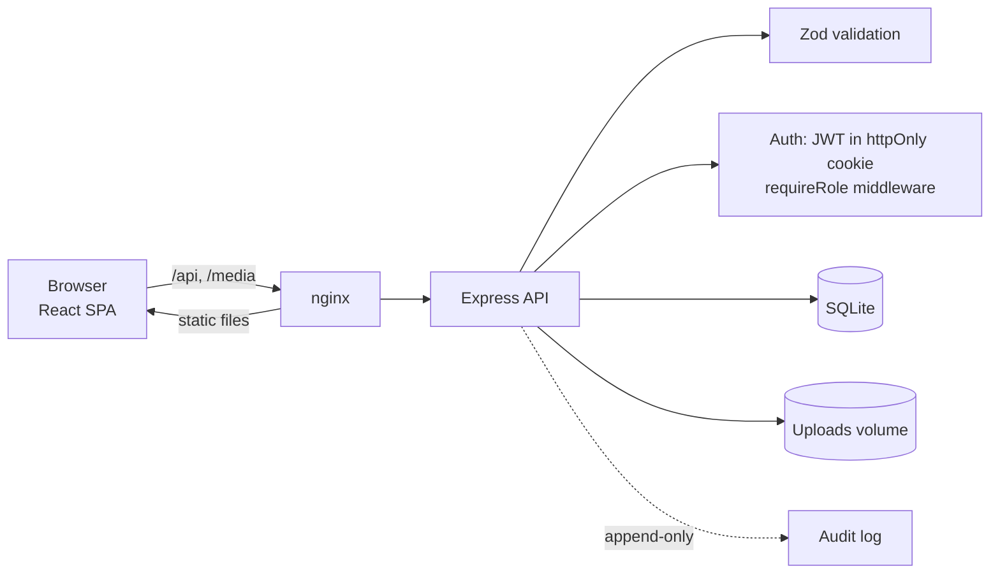
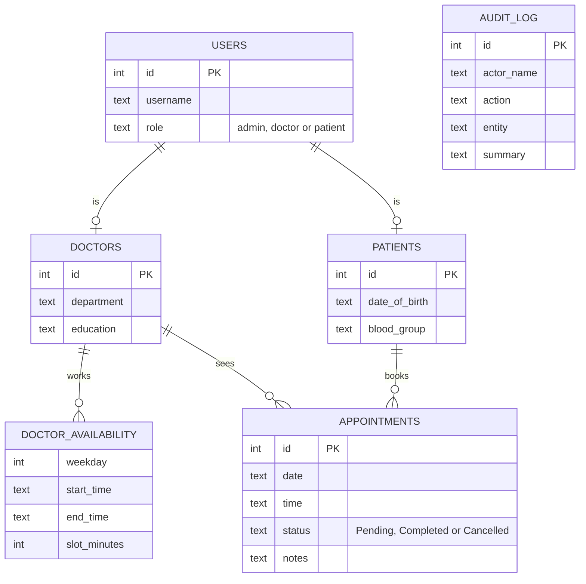

# Hospital Management System

A full-stack appointment and patient-management app with three role-based portals (patient, doctor, admin). Built with **Express 5**, **React 19 + Vite**, and **SQLite**, with the access-control, audit and booking-integrity concerns a real clinical system needs.

## Highlights

- **Slot-based booking.** Doctors publish weekly working hours; patients pick from a live grid of free times. Taken and past slots are never offered, and a unique database index (not just a check) makes double-booking impossible even under concurrent requests.
- **Role-based access, enforced on the server.** Patients see only their own appointments, doctors only their own patients, and other people's records return `404` so ids can't be probed.
- **Audit trail.** Sign-ins, failed logins, every create/update/delete, and every *staff view* of a patient record are logged with who, what and when. The log is append-only and outlives the users it names.
- **Search and pagination everywhere**, done server-side with escaped `LIKE` input.
- **Tested API.** Integration tests cover authentication, authorisation, booking rules, pagination and auditing against a real in-memory database.
- **One-command deploy** with Docker Compose (nginx serves the SPA and proxies the API) and a GitHub Actions pipeline.

## Features by role

| | Patient | Doctor | Admin |
|---|:-:|:-:|:-:|
| Self-register, edit profile and photo | ✅ | ✅ | |
| Browse doctors, book from free slots | ✅ | | ✅ (for any patient) |
| Cancel a pending appointment | ✅ | | ✅ |
| Set weekly working hours | | ✅ | ✅ (any doctor) |
| Complete appointments, write notes | | ✅ | ✅ |
| Manage doctors, patients, appointments | | | ✅ |
| Search, filter by status/date, paginate | ✅ | ✅ | ✅ |
| View the audit log | | | ✅ |

## Architecture





## Quick start

**With Docker** (runs everything, persists data in volumes):

```bash
cp .env.example .env            # set JWT_SECRET and SEED_ADMIN_PASSWORD
docker compose up --build       # http://localhost:8080
docker compose exec api node src/seed.js        # create the admin account
docker compose exec api node src/seed-demo.js   # optional: sample doctors, patients, appointments
```

**Without Docker** (Node ≥ 22.13):

```bash
cd backend && npm install && cp .env.example .env   # set JWT_SECRET, SEED_ADMIN_PASSWORD
npm run seed && npm run seed:demo && npm run dev     # API on :4000

cd frontend && npm install && npm run dev            # app on :5173
```

### Demo accounts

After `seed:demo`, all use the password `demo12345`:

| Role | Username |
|---|---|
| Admin | `demo.admin` |
| Doctor | `dr.mehta` |
| Patient | `demo.patient` |

Set `VITE_DEMO=true` and `VITE_DEMO_PASSWORD=demo12345` when building the frontend to show one-click demo buttons on the sign-in page (they are on by default in `npm run dev`). If you host a public demo, re-run `npm run seed:demo -- --reset` on a schedule, since the admin account can delete data.

## API overview

All routes are under `/api`; everything except `auth/*` requires a session.

| Area | Endpoints |
|---|---|
| Auth | `POST auth/login`, `auth/register`, `auth/logout`, `GET auth/me` |
| Doctors | `GET doctors?q=&page=`, `GET doctors/:id/slots?date=`, `GET/PUT doctors/:id/availability`, admin: `POST/PUT/DELETE doctors` |
| Patients | admin: `GET/POST/PUT/DELETE patients`; doctors may `GET` patients they treat |
| Appointments | `GET appointments?status=&from=&to=&q=&page=`, `POST`, `GET/PUT :id`, admin: `DELETE :id` |
| Me | `GET/PUT me/profile`, `GET me/dashboard` |
| Audit | admin: `GET audit?action=&entity=&q=&page=` |

Lists return `{ items, total, page, pageSize, totalPages }`. Validation errors return `400 { error, details: { field: message } }` so the UI can show messages next to the right input.

## Design decisions

- **Sessions:** 8-hour JWT in an `httpOnly`, `SameSite=Lax` cookie (no token in JavaScript). The user is re-read from the database on every request, so deleting an account ends its session immediately.
- **CSRF:** `SameSite` cookies plus an `Origin` check on every non-GET request.
- **Passwords:** bcrypt (cost 12); login is rate-limited and returns the same error and timing for unknown users and wrong passwords.
- **Uploads:** 2 MB JPEG/PNG/WebP only; files are renamed to random ids so client filenames are never trusted.
- **Integrity in the database, not just the code:** foreign keys with cascades (deleting a doctor removes their login, hours and appointments), `CHECK` constraints on enums, and the partial unique index on `(doctor, date, time)` for live appointments.
- **Patients cancel instead of delete**, so clinical history and notes are preserved; only admins can hard-delete.
- **Same-origin deployment:** the SPA and API share an origin (Vite proxy in dev, nginx in Docker), which keeps cookies simple and avoids CORS.

## Testing

```bash
cd backend && npm test
```

The suite boots the real Express app against an in-memory SQLite database and exercises it over HTTP: role access, ownership checks, slot generation, double-booking, cancellation rules, cascading deletes, pagination and `LIKE` escaping, and the audit trail.

## Project structure

```
backend/src/
  app.js, server.js        Express app and entrypoint
  db.js                    schema, constraints, transaction helper
  auth.js                  cookie session, requireAuth / requireRole
  routes/                  auth, doctors, patients, appointments, me, audit
  services/                profiles, appointments, availability (slot engine), audit
  seed.js, seed-demo.js    admin account / realistic sample data
backend/test/              API integration tests
frontend/src/
  pages/                   one file per screen
  components/              layout, forms, slot picker, availability editor, paging
  api.js, auth.jsx, hooks.js
docker-compose.yml         api + nginx-served web
.github/workflows/ci.yml   tests, build, audit, image builds
```

## Roadmap

Postgres with migrations, TypeScript with shared Zod schemas, email/SMS reminders, visit records with file attachments, a calendar view, and real-time slot updates.
